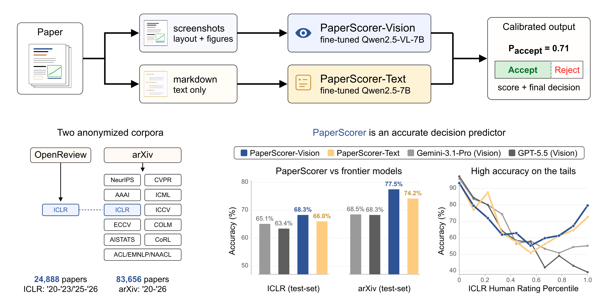

# PaperScorer

<p align="center">
  <a href="https://paperscorer-ai.com/">
    
  </a>
  <a href="https://huggingface.co/collections/zlab-princeton/paperscorer">
    
  </a>
  <a href="https://arxiv.org/abs/2610.31791">
    
  </a>
  <a href="https://sachinkonan.github.io/PaperScorer.html">
    
  </a>
</p>

<p align="center">
   Vision/Text models -> p_accept calibrated by temperature scaling with a base-rate term, plus the final decision; the OpenReview-ICLR and arXiv corpora; accuracy against Gemini-3.1-Pro and GPT-5.5 on both test sets and across ICLR rating percentiles" width="100%">
</p>

**PaperScorer** predicts the acceptance outcome of an ML paper from its **PDF** or **LaTeX source directory**. It consists of a suite of fine-tuned models, a paper-prep pipeline, a single-paper review UI, and an optional arXiv search/rerank deployment, all tied together by one orchestrator CLI (`paperscorer`).

We test our models on two datasets sourced from peer review: **OpenReview-ICLR** (ICLR submissions with decisions + reviewer ratings) and **arXiv-11 venues** (83K papers spanning eleven major ML conferences). PaperScorer-Vision is the strongest predictor across both, beating frontier reasoning models and coding-agent harnesses on Acc and AUC:

| Model                             | Modality | ICLR Acc | ICLR AUC | arXiv Acc | arXiv AUC |
|-----------------------------------|----------|---------:|---------:|----------:|----------:|
| Gemini-3.1-Pro                    | text     | 62.8     | 0.673    | 67.7      | 0.710     |
| Gemini-3.1-Pro                    | vision   | 65.1     | 0.690    | 68.5      | 0.736     |
| GPT-5.5                           | text     | 64.4     | 0.681    | 66.0      | 0.695     |
| GPT-5.5                           | vision   | 63.4     | 0.692    | 68.3      | 0.743     |
| GPT-5.5 (Codex Agent)             | both     | 55.3     | 0.667    | 56.2      | 0.683     |
| Sonnet-4.6 (Claude Agent)         | both     | 61.2     | 0.711    | 60.7      | 0.739     |
| Jev                               | text     | 63.4     | 0.682    | 60.6      | 0.659     |
| DeepReview-14B                    | text     | 64.9     | 0.667    | 61.6      | 0.699     |
| **PaperScorer-Text** (matched-source)   | text     | 66.0     | 0.721    | 74.2      | 0.815     |
| **PaperScorer-Vision** (matched-source) | vision   | **68.3** | **0.736**| **77.5**  | **0.843** |

All PaperScorer rows use the **7B** SFT checkpoint trained on the matched source (ICLR-trained for ICLR eval, arXiv-trained for arXiv eval) and its native Accept/Reject decision; each baseline row uses a decision threshold tuned on validation data when it raises Acc, as in the paper. Jev ([TypeSafe](https://typesafe.ai/blog/introducing-system-one-models-and-jev), version `jev-1.13.0`) returns an acceptance probability from text, so we run it zero-shot on the same text input as PaperScorer-Text; its accept cutoff is fit on the balanced validation set (p >= 0.32 for ICLR, p >= 0.29 for arXiv). All numbers are on the balanced test sets; [`tools/jev-baseline`](tools/jev-baseline) reproduces the Jev row. Numbers reproduce Table 3 of the paper.

---

## Quick start

```bash
git clone https://github.com/zlab-princeton/PaperScorer.git
cd PaperScorer
uv tool install .                          # installs the `paperscorer` command

paperscorer setup --serve
```

`paperscorer setup --serve` runs the wizard (cache → model → GPU), builds the child venvs, pulls the selected model from HuggingFace, and launches the web UI in one shot. Open `http://<host>:8003` in a browser and either upload a PDF or browse to a LaTeX source directory (optionally selecting from its git-commit history) to see the verdict. Drop the `--serve` flag to just configure + provision; run `paperscorer serve` separately when you want to launch.

---

## Customization

`paperscorer setup` walks you through three choices, all of which land in `./.paperscorer.toml`:

- **Model** — which of the 8 fine-tunes to score with: `{3b, 7b} × {text, vision} × {arxiv, iclr}`. `vision` (rendered page images) is the deployment default; `3b` is the lighter, well-calibrated choice.
- **GPU** — `local` (host has a CUDA GPU) or `slurm` (partition + walltime + optional `--constraint`).
- **Caches** — where `hf_home`, `uv_cache`, `vllm_cache`, `triton_cache`, and `data_root` should live (handy on shared clusters where the default `~/.cache` quotas are tight).

Revise any of these later with `paperscorer model` or `paperscorer gpu`, edit `./.paperscorer.toml` by hand, or run `paperscorer` with no args for a dashboard summarizing the current config and child-venv status.

---

## Retrieval server (optional)

[`tools/paperscorer-arxiv-server/`](tools/paperscorer-arxiv-server) stacks the PaperScorer **vision** reranker on top of [`arxiv_retriever`](tools/paperscorer-arxiv-server/external/arxiv_retriever) (included in this repo), with arXiv search results ranked by `0.3 · z(retriever_score) + 0.7 · p_accept`.

```bash
paperscorer setup --serve --with-retrieval
```

The CLI handles the rest — provisioning the FAISS indices + 80K-paper per-venue corpus, the conda env for `arxiv_retriever`, and launching both servers. If you've already run `paperscorer setup --with-retrieval`, `paperscorer serve --with-retrieval` launches the search UI on its own.

---

## Repository layout

| Path | Role |
|---|---|
| [`paperprep/`](paperprep) | PDF or LaTeX source → ShareGPT, via MinerU OCR · normalize · anonymize · arxiv-style filters · export. |
| [`paperscorer-training-and-inference/`](paperscorer-training-and-inference) | Training code, sbatches, and the `paperlens-serve` scoring server (vLLM-backed). Reproduces the released models. |
| [`tools/paperscorer-reviewing/`](tools/paperscorer-reviewing) | Single-paper review web UI — what `paperscorer serve` launches. PDF upload or LaTeX dir + git-commit history. |
| [`tools/paperscorer-arxiv-server/`](tools/paperscorer-arxiv-server) | Optional retrieval + rerank deployment (above). |
| [`src/paperscorer_orchestrator/`](src/paperscorer_orchestrator) | The `paperscorer` CLI — config (`.paperscorer.toml`), wizard, child-venv builder, run/serve entry points. |

Each component has its own README with deeper docs and per-component install steps.

### Released artifacts

- **Models** — 8 fine-tunes on [HuggingFace](https://huggingface.co/collections/zlab-princeton/paperscorer): `{3b, 7b} × {text, vision} × {arxiv, iclr}`.
- **Datasets** — [`skonan/PaperScorer-Text`](https://huggingface.co/datasets/skonan/PaperScorer-Text) and [`skonan/PaperScorer-Vision`](https://huggingface.co/datasets/skonan/PaperScorer-Vision) (page-image bytes embedded; subsets `arxiv` + `openreview-iclr`).

---

## Python Usage Examples

Once `paperscorer serve` is running, all submission endpoints are vanilla JSON
over HTTP — no custom client needed. See
[`tools/paperscorer-reviewing#api-surface`](tools/paperscorer-reviewing/README.md#api-surface)
for the full endpoint reference; the snippets below cover the common cases.

```python
import requests, time
BASE = "http://localhost:8003"      # paperlensreview port (configs/server.yaml)

def wait(job_id, *, agent=False):
    while True:
        s = requests.get(f"{BASE}/status/{job_id}").json()
        line = f"[{s['stage']}] {(s['stage_index'] or 0) + 1}/{s['total_stages']}"
        if agent: line += f"  agent={s.get('agent_state')}"
        print(line)
        if s["state"] in ("done", "error"): return s
        time.sleep(1.5)
```

### Submit a PDF

```python
with open("paper.pdf", "rb") as f:
    r = requests.post(f"{BASE}/submit", files={"file": f}).json()
res = wait(r["job_id"])["result"]
print(res["decision"], f"p_accept={res['p_accept']:.3f}")
# -> Accept p_accept=0.881
```

### Submit an arXiv id (live download + paperprep anonymization)

```python
r = requests.post(f"{BASE}/submit_arxiv",
                  json={"arxiv_id": "2111.06377"}).json()
res = wait(r["job_id"])["result"]
print(res["decision"], f"p_accept={res['p_accept']:.3f}  source={res['source_type']}")
```

### Submit a LaTeX source dir (server-side path)

```python
r = requests.post(f"{BASE}/submit_latex",
                  json={"path": "/abs/path/to/your/latex_repo",
                        "mode": "latest",
                        "main_tex": None}).json()      # auto-detect entrypoint
res = wait(r["job_id"])["result"]
print(res["decision"], f"p_accept={res['p_accept']:.3f}")
```

### Submit with an agentic review (Claude or Codex)

The agent stage runs two parallel reviews — `no_prior` reads the paper blind
while `with_prior` sees the calibrated PaperScorer `p_accept` injected into its
workspace as a Bayesian prior. Both produce a structured 11-field review.

The snippet below skips the live transcript stream and just prints each
review as soon as that variant finishes (one usually completes before the
other; the loop exits when both are done):

```python
with open("paper.pdf", "rb") as f:
    r = requests.post(f"{BASE}/submit",
                      files={"file": f},
                      data={"agent": "claude"}).json()  # or "codex"
job_id = r["job_id"]
print(f"submitted {job_id} with agent={r['agent']}")

printed = set()
while True:
    s = requests.get(f"{BASE}/status/{job_id}").json()
    for variant in ("no_prior", "with_prior"):
        if variant in printed: continue
        if (s.get("agent_state") or {}).get(variant) not in ("done", "error"): continue
        # Grab this variant's final predictions (single fetch; no event loop).
        ev = requests.get(f"{BASE}/jobs/{job_id}/agent_events",
                          params={"variant": variant, "since": 10**9, "limit": 1}).json()
        preds = (ev.get("result") or {}).get("predictions") or {}
        print(f"\n=== {variant}  ({ev['state']}) ===")
        if preds:
            print(f"decision={preds['decision']}  rating={preds['rating']}/10  "
                  f"conf={preds['confidence']}/5")
            print(f"summary:    {preds.get('summary', '')[:300]}")
            print(f"weaknesses: {preds.get('weaknesses', '')[:300]}")
        else:
            print("(no predictions returned — agent failed or schema invalid)")
        printed.add(variant)
    if s["state"] in ("done", "error"): break
    time.sleep(1.5)
```

For the live tool-call stream the UI renders, walk events from
`/jobs/{id}/agent_events?variant=...&since=N` and inspect `kind` ∈
`{text, tool_call, tool_result, status, done, error}`.

### Submit a git history with specific commits

You pick the commits — no churn-based pre-selection. Each commit is
git-archived into an isolated tree, anonymized + compiled by paperprep,
then scored. Results land on `result["trajectory"]` (oldest → newest).

```python
commits = [{"sha": sha} for sha in [
    "a1b2c3d",     # short or full sha both work
    "e4f5g6h",
    "i7j8k9l",
]]
r = requests.post(f"{BASE}/submit_latex",
                  json={"path": "/abs/path/to/your/latex_repo",
                        "mode": "history",
                        "commits": commits}).json()
res = wait(r["job_id"])["result"]
for rec in res["trajectory"]:
    print(f"{rec['short']}  {rec['date']}  {rec['state']:7s}  "
          f"p_accept={rec.get('p_accept', '-')!s:>6}  {rec['subject'][:60]}")
```

If you'd rather have the server suggest commits ranked by `.tex` churn,
hit `POST /probe_latex` first — it returns the last N commits touching
`*.tex` with a `churn` field per commit and an `above_pct` pre-selection
flag at your chosen percentile cutoff.

---

## Citation

If you use PaperScorer in your research, please cite our NeurIPS 2026 paper:

```bibtex
@inproceedings{konan2026paperscorer,
  title     = {PaperScorer: How Predictable Is Paper Acceptance?},
  author    = {Konan, Sachin and Liu, Jonathan and Liu, Zhuang},
  booktitle = {Advances in Neural Information Processing Systems},
  year      = {2026}
}
```

---

## License

PaperScorer is released under the [MIT License](LICENSE). [`paperscorer-training-and-inference/`](paperscorer-training-and-inference) builds on [LLaMA-Factory](https://github.com/hiyouga/LLaMA-Factory) and keeps its [Apache-2.0 license](paperscorer-training-and-inference/LICENSE).
